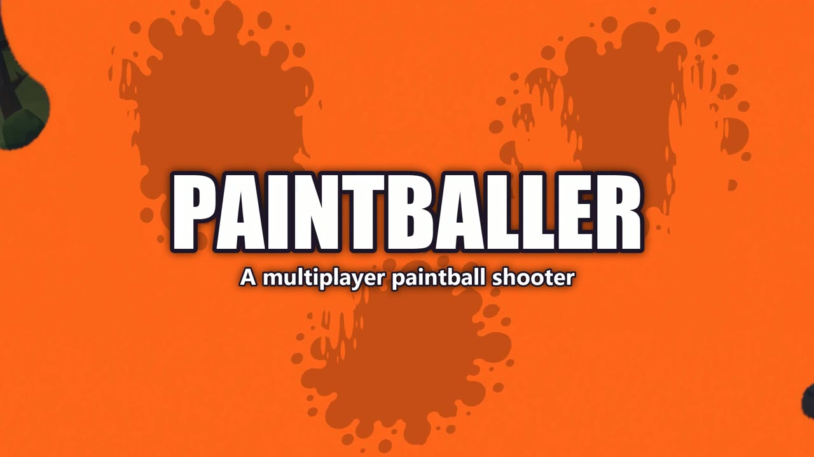

# Paintballer

**A multiplayer first-person paintball shooter built in Unity 6, headed for Steam on Windows.**

> 🎮 Status: in development, July 2026 to now. The source code is private; this page shows the game and how it was built.

### ▶ Watch the trailer

[](media/trailer.mp4)

<sub>41 seconds: the in-game opening cinematic, a glimpse of the Evacuate intro (plane, robot landing, news broadcast), then the main features. Click the image to open the MP4.</sub>

<!-- MEDIA TODO: add 3–4 gameplay screenshots to media/ (Classic round, Evacuate robot vs hunters, lobby, buy menu) and link them here -->

---

## The game

Paintballer has two modes, plus a social lobby:

| Mode | What it is |
|---|---|
| **Classic** | Round-based team play across nine maps: plant the paint bomb at a site or wipe the other team. Includes halftime, a buy economy, and destructible props that keep their paint splatter. |
| **Evacuate** | Asymmetric co-op: a team of hunters against one player-controlled robot that evolves new abilities. Hunters earn money, buy permanent upgrades, haul gas cans, and fight their way to an evacuation train. |
| **Lobby** | A shared space where players play a physics ball game and talk on voice chat while the host sets up the match. |

## What I built

I designed and programmed the game myself: about **190 C# gameplay scripts, ~65,000 lines**, across **170+ commits**.

- **Networking.** Server-authoritative multiplayer on **FishNet**, running Steam and direct-IP transports side by side. Supports **Steam lobbies** and invites, and dedicated servers through the **Edgegap** plugin.
- **Voice chat.** **Vivox** voice with game-aware routing: everyone hears each other in the lobby, only teammates in a match, and dead players only hear other dead teammates. Includes push-to-talk on keyboard or gamepad, device pickers, a speaking indicator, and per-player mute from the scoreboard.
- **Game systems.** Round and match state machines, a bomb plant and defuse flow with reset edge cases handled, a buy economy and loadouts, health with hitboxes, grenades, special powers, and a robot ability and evolution system.
- **Evacuate balance.** Economy, income, upgrade and ammo tuning all live in data, so designers can rebalance it in the Inspector without code changes.
- **Look and feel.** URP rendering, paint explosions and meshes that shatter, persistent paint splats, a GPU grass system with per-map profiles, a map sky system, Cinemachine intro cinematics, and an announcer.
- **Player experience.** Full gamepad and keyboard input (new Input System), button prompts, an emote wheel, compass and objective markers, accessibility, video and crosshair settings, and an on-screen virtual keyboard for controller players.
- **Release engineering.** An automated release-check suite (14 checks), clean Steam depot builds with SHA-256 manifests, headless smoke tests, and an asset licence ledger for every third-party pack.

## Tech stack

`Unity 6 (URP)` · `C#` · `FishNet` · `Steamworks.NET` · `Unity Gaming Services: Vivox + Authentication` · `Edgegap` · `Cinemachine` · `Input System` · `Animation Rigging` · `Shader Graph` · `Timeline`

## Code sample

[`code-samples/VoiceChatRouter.cs`](code-samples/VoiceChatRouter.cs) is the component that turns game state into voice-chat channel changes. It shows how the voice system was added **without editing the match or lobby code**:

- It reads only existing public APIs: lobby state, the local player's team, and alive or dead state.
- It sends updates only when something actually changes.
- It is a safe no-op when the Vivox package isn't installed.

## Architecture at a glance

```
            ┌──────────────── Host / dedicated server (authoritative) ────────────────┐
            │  LobbyManager ─► MatchManager / EvacuateMatchManager ─► Health, Economy  │
            └──────────────────────────────▲──────────────────────────────────────────┘
                                           │ FishNet (Steam or direct-IP transport)
            ┌──────────────────────────────┴──────────── Client ──────────────────────┐
            │  PlayerController ─ Weapons ─ HUDs ─ Cinematics ─ Settings               │
            │  VoiceChatRouter ──► VoiceChatManager ──► Vivox (separate cloud channel) │
            └─────────────────────────────────────────────────────────────────────────┘
```

## Play it

<!-- DEMO TODO: link the itch.io / Steam page once a limited demo build is published -->
A playable demo is coming. Contact me for a private playtest build.

---

© 2026 Hunter Miller. All rights reserved. See [LICENSE](LICENSE).
